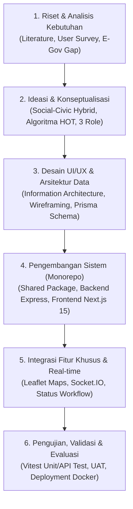
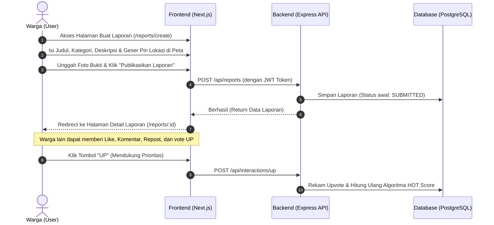
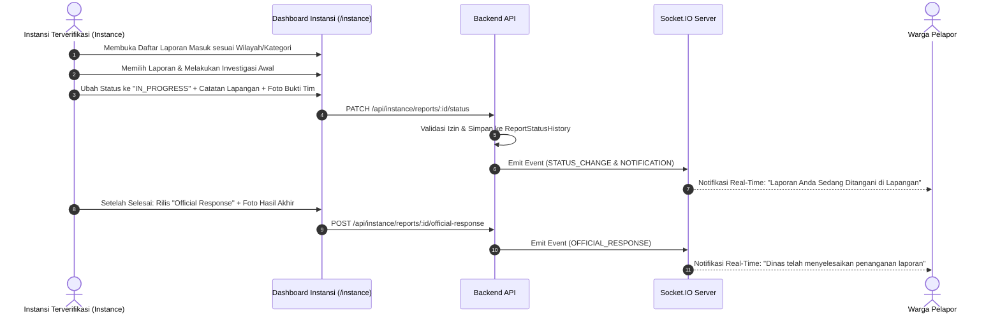
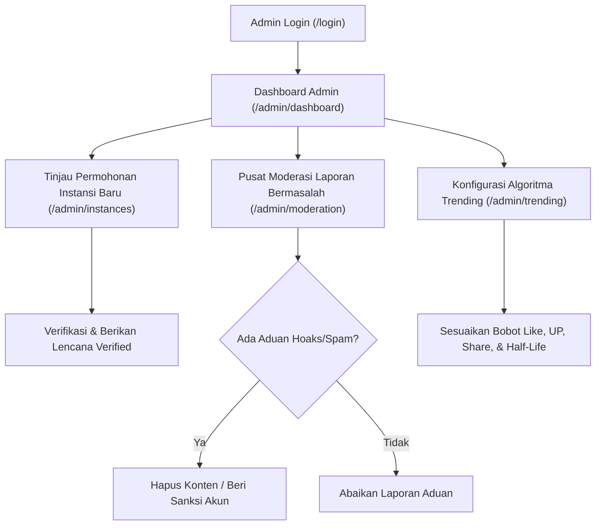

# PROPOSAL KARYA TEKNOLOGI INFORMASI

---

# SUARAKSI: PLATFORM CIVIC REPORTING & SOCIAL ACCOUNTABILITY BERBASIS WEB DENGAN ALGORITMA TRENDING DAN TRANSPARANSI MULTI-ROLE UNTUK PENINGKATAN RESPONSIFITAS PELAYANAN PUBLIK

**Disusun Oleh [Nama Tim] :**  
- **[Nama Ketua Tim]** - [Nama Universitas / Perguruan Tinggi]
- **[Nama Anggota 1]** - [Nama Universitas / Perguruan Tinggi]
- **[Nama Anggota 2]** - [Nama Universitas / Perguruan Tinggi]

---

## DAFTAR ISI

- [DAFTAR ISI](#daftar-isi)
- [KATA PENGANTAR](#kata-pengantar)
- [BAB I: PENDAHULUAN](#bab-i-pendahuluan)
  - [1.1 Latar Belakang](#11-latar-belakang)
  - [1.2 Tujuan](#12-tujuan)
  - [1.3 Manfaat](#13-manfaat)
- [BAB II: RANCANGAN SISTEM](#bab-ii-rancangan-sistem)
  - [2.1 Tema](#21-tema)
  - [2.2 Alat dan Bahan](#22-alat-dan-bahan)
  - [2.3 Alur Pembuatan](#23-alur-pembuatan)
- [BAB III: HASIL DAN PEMBAHASAN](#bab-iii-hasil-dan-pembahasan)
  - [3.1 Analisis Desain Karya](#31-analisis-desain-karya)
    - [3.1.1 Target Pengguna](#311-target-pengguna)
    - [3.1.2 Batasan Aplikasi](#312-batasan-aplikasi)
    - [3.1.3 Platform yang Digunakan](#313-platform-yang-digunakan)
    - [3.1.4 User Persona](#314-user-persona)
    - [3.1.5 Analisis SWOT](#315-analisis-swot)
  - [3.2 User Flow dan Information Architecture](#32-user-flow-dan-information-architecture)
    - [3.2.1 User Flow](#321-user-flow)
    - [3.2.2 Information Architecture (IA)](#322-information-architecture-ia)
  - [3.3 Wireframe](#33-wireframe)
- [BAB IV: PENUTUP](#bab-iv-penutup)
  - [4.1 Kesimpulan](#41-kesimpulan)
  - [4.2 Saran (Pengembangan Masa Depan)](#42-saran-pengembangan-masa-depan)
- [LAMPIRAN](#lampiran)
- [DAFTAR PUSTAKA](#daftar-pustaka)

---

## KATA PENGANTAR

Puji dan syukur kami panjatkan ke hadirat Tuhan Yang Maha Esa atas segala rahmat, hidayah, dan karunia-Nya, sehingga kami dapat menyelesaikan penyusunan proposal karya teknologi informasi dengan judul **"SuarAksi: Platform Civic Reporting & Social Accountability Berbasis Web dengan Algoritma Trending dan Transparansi Multi-Role untuk Peningkatan Responsifitas Pelayanan Publik"**.

Karya ini dirancang dan dikembangkan sebagai ikhtiar solutif atas kesenjangan (*gap*) komunikasi antara aspirasi masyarakat sipil dengan instansi pemerintah dalam penanganan fasilitas dan permasalahan publik. Melalui perpaduan daya tarik keterlibatan media sosial (*civic social network*) dan akuntabilitas tata kelola pemerintahan terbuka (*open governance*), SuarAksi dihadirkan untuk mewujudkan ekosistem pelaporan publik yang transparan, terukur, dan berdampak nyata bagi lingkungan sekitar.

Penyusunan proposal ini tentu tidak terlepas dari bimbingan, arahan, dan dukungan moril dari berbagai pihak. Oleh karena itu, perkenankan kami menyampaikan ucapan terima kasih yang tulus dan mendalam kepada:
1. Dosen Pembimbing yang senantiasa memberikan arahan strategis, masukan konstruktif, serta bimbingan metodologis selama proses perancangan sistem;
2. Seluruh Dewan Juri dan Panitia Penyelenggara yang telah memberikan wadah dan ruang apresiasi bagi inovasi teknologi generasi muda Indonesia;
3. Civitas akademika [Nama Universitas] atas fasilitas dan ekosistem riset yang mendukung keberlangsungan karya ini;
4. Rekan-rekan tim yang telah mendedikasikan waktu, tenaga, dan pemikiran dalam membangun prototipe perangkat lunak ini secara komprehensif.

Kami menyadari bahwa proposal ini masih memiliki ruang penyempurnaan. Oleh karena itu, kami senantiasa terbuka menerima kritik, saran, dan masukan membangun demi kematangan implementasi sistem ini di dunia nyata. Besar harapan kami, karya SuarAksi ini dapat memberikan kontribusi nyata dalam percepatan transformasi digital menuju tata kelola kota yang cerdas (*smart city*) dan partisipatif.

[Kota Asal], 11 November 2026  
*Ketua Tim Pengusul,*

*(Tanda Tangan)*  
**[Nama Ketua Tim]**  
NIM. [Nomor Induk Mahasiswa]

---

## BAB I: PENDAHULUAN

### 1.1 Latar Belakang

Perkembangan infrastruktur dan layanan publik di era urbanisasi yang pesat menuntut kecepatan respons dan pemeliharaan yang berkesinambungan. Namun, dalam realitas sehari-hari, masyarakat seringkali menghadapi berbagai kendala fisik di sekitarnya, mulai dari jalan berlubang, lampu penerangan jalan mati, tumpukan sampah liar, saluran drainase tersumbat, hingga disfungsi fasilitas umum. Permasalahan tersebut tidak hanya menurunkan kualitas hidup masyarakat, tetapi juga mengancam keselamatan jiwa para pengguna jalan dan fasilitas perkotaan.

Di tengah situasi tersebut, berkembang sebuah fenomena sosial yang dikenal di ruang publik digital Indonesia sebagai **"No Viral, No Justice"** atau **"Viral First, Action Later"**. Masyarakat merasa bahwa jalur formal pelaporan birokrasi konvensional berjalan lambat, tertutup, dan minim kepastian tindak lanjut. Akibatnya, masyarakat cenderung memviralkan keluhan infrastruktur ke platform media sosial umum seperti X (sebelumnya Twitter), Instagram, maupun TikTok. Meskipun media sosial terbukti ampuh menarik perhatian publik secara instan, pemanfaatan media sosial umum untuk pelaporan sipil (*civic reporting*) memiliki kelemahan mendasar:
1. **Ketiadaan Struktur Data & Koordinat Presisi:** Keluhan yang diunggah di linimasa medsos tidak memiliki standarisasi atribut (seperti kategori baku, titik koordinat geografis presisi, dan identitas instansi yang berwenang), sehingga menyulitkan dinas terkait untuk menindaklanjuti secara akurat di lapangan.
2. **Ketiadaan Pelacakan Status & Transparansi (*Status Tracking Void*):** Percakapan di media sosial cepat tenggelam oleh isu-isu baru (*buried by timeline algorithm*). Publik tidak memiliki instrumen untuk memantau apakah keluhan yang viral benar-benar dikerjakan, sedang ditinjau, atau diabaikan begitu saja.
3. **Rawan Hoaks, Isu Ganda, dan Pelintiran Informasi:** Tanpa adanya mekanisme verifikasi resmi, aduan di media sosial rentan disusupi narasi provokatif, hoaks, atau pelaporan berulang (*duplicate reports*) yang menguras sumber daya penanganan.

Di sisi lain, platform pengaduan resmi pemerintah yang ada saat ini umumnya dibangun dengan paradigma birokrasi tertutup (*closed silo-system*). Antarmuka pengguna (UI/UX) yang kaku, alur pelaporan yang rumit, dan hilangnya aspek partisipasi publik menyebabkan rendahnya tingkat keterlibatan masyarakat (*civic engagement*). Laporan yang dikirimkan warga seolah masuk ke dalam "kotak hitam" birokrasi, di mana warga tidak dapat saling mendukung, memvalidasi keparahan isu, atau memberikan pengawasan sosial bersama.

Berdasarkan permasalahan mendesak tersebut, diperlukan sebuah platform jembatan yang revolusioner. **SuarAksi** hadir sebagai *Civic Reporting & Social Accountability Platform* yang memadukan keunggulan dinamika media sosial (interaksi publik, algoritma *trending*, dan linimasa terbuka) dengan ketatnya akuntabilitas penanganan birokrasi instansi pemerintah (verifikasi kelembagaan, 6 level pembaruan status resmi, unggah bukti penanganan lapangan, dan integrasi geospasial interaktif). Dengan SuarAksi, partisipasi masyarakat tidak lagi berhenti pada viralitas sesaat, melainkan berujung pada aksi nyata yang dapat diawasi secara transparan oleh seluruh lapisan publik.

### 1.2 Tujuan

Tujuan utama dari perancangan dan pengembangan karya teknologi SuarAksi adalah:
1. Merancang dan mengimplementasikan arsitektur perangkat lunak berbasis web (*monorepo full-stack*) yang mengintegrasikan tiga peran pengguna (*multi-role*): Masyarakat Umum (*User*), Instansi Pemerintah Terverifikasi (*Instance*), dan Administrator Pengawas (*Admin*).
2. Membangun mekanisme transparansi dua arah melalui linimasa pelaporan publik yang dilengkapi dengan sistem riwayat penanganan 6 tahap (*SUBMITTED*, *UNDER_REVIEW*, *VERIFIED*, *IN_PROGRESS*, *RESOLVED*, *REJECTED*) serta penerbitan tanggapan resmi instansi (*Official Response*) berlampiran bukti dokumentasi lapangan.
3. Mengembangkan dan menerapkan **Algoritma HOT & Trending** berbasis pembobotan interaksi sosial (*Like*, *Comment*, *Repost*, *UP*, *Share*) dengan fungsi peluruhan waktu (*time-decay formula*) guna memprioritaskan isu-isu publik yang paling kritis dan mendesak secara objektif.
4. Mengintegrasikan teknologi pemetaan geospasial interaktif (*Leaflet & OpenStreetMap*) untuk penentuan titik lokasi kerusakan secara presisi dan visualisasi persebaran laporan di tingkat kota/wilayah.
5. Menyediakan mekanisme komunikasi waktu nyata (*real-time notifications & updates*) menggunakan Socket.IO untuk menjamin pembaruan status dan interaksi masyarakat dapat tersampaikan seketika tanpa perlu memuat ulang halaman.

### 1.3 Manfaat

Pengembangan platform SuarAksi memberikan manfaat signifikan bagi berbagai pihak:

1. **Bagi Masyarakat Umum (Warga):**
   - **Kemudahan Pelaporan:** Mempermudah warga dalam melaporkan permasalahan lingkungan dan fasilitas umum dalam hitungan detik dengan dukungan tangkapan foto dan penandaan titik GPS akurat.
   - **Kekuatan Kolaborasi Kolektif:** Fitur interaksi (khususnya tombol dukungan **UP**) memungkinkan warga menyatukan suara untuk mengangkat isu genting ke tangga teratas *Trending*, sehingga memutus fenomena aduan diabaikan.
   - **Transparansi & Kepastian:** Memberikan kejelasan progres tindak lanjut dari instansi yang berwenang secara terbuka, menghapus rasa curiga dan ketidakpastian.

2. **Bagi Instansi Pemerintah (Dinas Teknis & BUMD):**
   - **Manajemen Aduan Terstruktur:** Menggantikan tumpukan aduan medsos yang acak dengan *dashboard* terpusat yang tersaring berdasarkan wilayah yurisdiksi dan kategori tugas pokok fungsi (tupoksi).
   - **Verifikasi & Validasi Lapangan:** Memudahkan petugas di lapangan menemukan lokasi kerusakan fisik melalui titik koordinat geospasial yang tepat.
   - **Membangun Akuntabilitas & Reputasi Positif:** Memberikan wadah resmi bagi instansi untuk memamerkan hasil kerja nyata mereka lewat bukti foto "sebelum dan sesudah" (*before-after evidence*), sehingga meningkatkan kepuasan publik terhadap kinerja pemerintah.
   - **Analitik Kinerja Berbasis Data:** Fitur analitik tingkat penyelesaian (*resolution rate*) membantu pimpinan instansi mengevaluasi kecepatan dan efektivitas kerja tim teknis.

3. **Bagi Pengambil Kebijakan & Pemerintah Daerah (Smart Governance):**
   - **Data-Driven Decision Making:** Menjadi dasar perencanaan anggaran perbaikan infrastruktur berbasis konsentrasi titik panas (*hotspot*) masalah di peta digital kota.
   - **Harmonisasi Hubungan Warga-Negara:** Mengembalikan kepercayaan masyarakat terhadap institusi publik melalui keterbukaan informasi dan kolaborasi partisipatif.

---

## BAB II: RANCANGAN SISTEM

### 2.1 Tema

- **Tema Utama:** *Smart Governance, Civic Technology, and Public Service Digital Transformation.*
- **Subtema:** *"Inovasi Teknologi Web Berbasis Kolaborasi Sosial dan Geospasial untuk Mewujudkan Pelayanan Publik yang Transparan, Akuntabel, dan Responsif."*

**Alasan Pemilihan Tema:**  
Tema ini dipilih karena sejalan dengan agenda prioritas nasional mengenai Transformasi Digital Sektor Publik dan Inisiatif Kota Cerdas (*Smart City*). Tantangan terbesar pelayanan publik saat ini bukan lagi semata ketiadaan infrastruktur teknologi, melainkan rendahnya adopsi dan kepercayaan masyarakat terhadap kanal-kanal resmi yang ada. Dengan mengangkat pendekatan *Civic Tech* yang bernuansa jejaring sosial, SuarAksi mendemokratisasi pengawasan publik dan mempercepat penanganan masalah perkotaan secara terukur.

### 2.2 Alat dan Bahan

Perancangan dan pembangunan sistem SuarAksi memanfaatkan perangkat keras dan perangkat lunak standar industri modern dengan susunan arsitektur *monorepo* yang terisolasi dan mudah diskalakan:

#### A. Perangkat Keras (Hardware Development & Testing)
1. Unit Komputer/Laptop Pengembang: Processor Multi-core (AMD Ryzen 7 / Intel Core i7), RAM 16 GB DDR4/DDR5, NVMe SSD 512 GB.
2. Perangkat Uji Responsif: Monitor Desktop resolusi Full HD (1920x1080) dan Smartphone Android/iOS (layar 5.8" hingga 6.7") untuk pengujian antarmuka multi-resolusi.

#### B. Perangkat Lunak & Stack Teknologi (Software & Tech Stack)
Berikut adalah rincian teknologi yang digunakan dalam proyek SuarAksi:

| Komponen Arsitektur | Teknologi / Pustaka | Versi | Peran & Alasan Penggunaan |
| :--- | :--- | :--- | :--- |
| **Frontend Framework** | **Next.js (App Router)** | `15.1.7` | Framework React generasi terbaru dengan kapabilitas Server Components, routing terstruktur, dan optimasi performa rendering tinggi. |
| **UI Library** | **React & React-DOM** | `19.0.0` | Pustaka antarmuka deklaratif berbasis komponen untuk pengalaman pengguna yang dinamis dan modular. |
| **Bahasa Pemrograman** | **TypeScript** | `5.6.3` | Memberikan keamanan tipe statis (*static typing*) lintas frontend, backend, dan shared library guna meminimalisir kesalahan *runtime*. |
| **CSS & Desain Sistem** | **Tailwind CSS** | `3.4.17` | Utility-first CSS framework untuk styling responsif, modern, dan konsisten dengan palet warna crimson & neutral slate. |
| **Ikonografi Antarmuka** | **Lucide React** | `0.475.0` | Kumpulan ikon SVG konsisten dan ringan untuk elemen navigasi, indikator status, dan tombol aksi. |
| **Validasi Skema & Form** | **Zod & React Hook Form** | `3.23.8` / `7.54.2` | Validasi input form yang ketat di sisi klien maupun server (*single source of truth schema*). |
| **State & Server Cache** | **TanStack React Query** | `5.66.9` | Manajemen sinkronisasi data server, pemuatan *asynchronous*, *background refetching*, dan penanganan *caching*. |
| **Peta Geospasial** | **Leaflet & OpenStreetMap** | `1.9.4` | Pustaka pemetaan interaktif open-source yang ringan untuk penandaan koordinat, popup lokasi, dan visualisasi spasial. |
| **Backend Runtime** | **Node.js & Express.js** | `v20+` / `4.21.2` | Runtime JavaScript asynchronous dan framework web minimalis berkinerja tinggi untuk menangani REST API. |
| **Komunikasi Real-Time** | **Socket.IO** (Client & Server) | `4.8.1` | Pustaka WebSocket dengan fallback otomatis untuk pengiriman notifikasi instan, pembaruan interaksi, dan notifikasi status. |
| **Basis Data Relasional** | **PostgreSQL** | `v16` (Docker) | Sistem manajemen basis data relasional enterprise-grade yang andal dalam relasi kompleks, indexing cepat, dan integritas data. |
| **Object-Relational Mapping** | **Prisma ORM** | `6.4.1` | Type-safe ORM modern untuk pemodelan skema, migrasi basis data otomatis, dan manipulasi data berkecepatan tinggi. |
| **Keamanan & Autentikasi** | **JWT & bcrypt** | `9.0.2` / `5.1.1` | Hashing kata sandi berbasis salt (10 rounds) dan otorisasi sesi berbasis token stateless untuk REST API. |
| **Penanganan Berkas** | **Multer** | `1.4.5` | Middleware pemrosesan multipart/form-data untuk pengunggahan bukti foto laporan dan bukti penyelesaian. |
| **Kerangka Pengujian** | **Vitest & Supertest** | `3.0.7` / `7.0.0` | Unit test dan automated endpoint integration test berkecepatan tinggi untuk menjamin reliabilitas API. |
| **Manajemen Dependensi** | **NPM Workspaces** | Native | Manajemen repositori tunggal (*monorepo*) yang mengaitkan paket `@suaraksi/shared`, `apps/web`, dan `apps/api`. |
| **Kontainerisasi & DevTools**| **Docker & Docker Compose**| `v26+` | Standardisasi lingkungan basis data PostgreSQL lokal yang terisolasi dan mudah direplikasi. |

### 2.3 Alur Pembuatan

Proses perancangan dan pengembangan SuarAksi dijalankan secara sistematis dan berulang (*iterative-incremental*) melalui 6 tahapan utama yang terintegrasi:



#### Penjelasan Tahapan Alur Pembuatan:

1. **Tahap 1: Riset dan Analisis Masalah (*Research & Need Assessment*)**
   - Melakukan studi literatur mengenai kelemahan sistem pengaduan birokrasi dan dinamika media sosial di Indonesia.
   - Mengidentifikasi kebutuhan fungsional dari tiga pemangku kepentingan: warga yang butuh kemudahan melapor, dinas yang butuh akurasi data & koordinat, serta admin yang butuh tata kelola moderasi terintegrasi.
   - Menetapkan indikator keberhasilan sistem: transparansi status, akurasi lokasi, dan kemampuan viralitas yang terkontrol.

2. **Tahap 2: Ideasi dan Formulasi Konseptual (*System Concept & Mathematical Ideation*)**
   - Mengembangkan konsep inovasi penggabungan linimasa sosial dengan proses bisnis pelayanan publik.
   - Merumuskan formula matematis **HOT Score** dengan parameter bobot interaksi (*Like*, *Comment*, *Repost*, *UP*, *Share*) dan fungsi peluruhan eksponensial waktu (*half-life decay*) agar isu-isu lama yang sudah usang tidak terus mendominasi linimasa teratas.
   - Mendefinisikan matriks hak akses (*Role-Based Access Control / RBAC*) untuk `USER`, `INSTANCE`, dan `ADMIN`.

3. **Tahap 3: Desain UI/UX dan Pemodelan Basis Data (*Design & Database Modeling*)**
   - Merancang *Information Architecture* (IA) untuk memastikan navigasi halaman intuitif.
   - Membuat sketsa *Wireframe* (Low-Fidelity hingga High-Fidelity) dengan pendekatan antarmuka tiga kolom (*three-column modern layout*) yang akrab bagi pengguna media sosial modern.
   - Merancang skema relasi basis data pada Prisma (`schema.prisma`), mencakup tabel `User`, `InstanceProfile`, `Category`, `Report`, `ReportMedia`, `ReportStatusHistory`, `OfficialResponse`, `Upvote`, `Like`, `Comment`, `Notification`, `ContentReport`, dan `AuditLog`.

4. **Tahap 4: Pengembangan Sistem Inti (*Core System Engineering*)**
   - Membangun struktur repositori tunggal (*monorepo*) dengan pustaka bersama `packages/shared` untuk sinkronisasi tipe data Zod dan antarmuka TypeScript.
   - Mengembangkan RESTful API dengan Express.js yang menangani modul autentikasi JWT, CRUD laporan, sistem interaksi sosial, dan modul khusus instansi pemerintah.
   - Mengembangkan antarmuka modern dengan Next.js 15 App Router, Tailwind CSS, dan TanStack Query.

5. **Tahap 5: Integrasi Geospasial, Algoritma, dan Komunikasi Real-Time**
   - Mengintegrasikan Leaflet dan OpenStreetMap pada formulir laporan (`ReportMap.tsx`), memungkinkan pemilihan koordinat interaktif dengan pin geser (*draggable marker*).
   - Mengimplementasikan *engine* kalkulasi HOT Score di sisi backend yang otomatis memperbarui skor popularitas laporan setiap kali terjadi interaksi.
   - Mengonfigurasi WebSocket melalui Socket.IO untuk pembaruan linimasa dan penerimaan notifikasi instan saat status laporan diperbarui oleh dinas terkait.

6. **Tahap 6: Pengujian, Validasi, dan Finalisasi (*Testing, Validation & Seeding*)**
   - Melakukan pengujian otomatis (*automated testing*) menggunakan Vitest dan Supertest untuk memvalidasi keamanan endpoint API, otorisasi token, dan integritas data transaksi.
   - Menjalankan migrasi basis data dan *data seeding* realistis (`prisma/seed.ts`) yang mencakup instansi riil (Dinas Bina Marga, Dinas Perhubungan, Dinas Lingkungan Hidup), kategori publik lengkap, serta simulasi interaksi riil.
   - Evaluasi responsivitas tata letak di berbagai ukuran layar dan optimalisasi performa *build*.

---

## BAB III: HASIL DAN PEMBAHASAN

Sistem SuarAksi telah berhasil diimplementasikan secara utuh sebagai platform aplikasi web modern yang fungsional, responsif, dan siap diuji pakai. Bagian ini menguraikan analisis desain karya, profil pengguna, matriks SWOT, arsitektur informasi, alur interaksi pengguna, serta representasi tata letak wireframe sistem.

### 3.1 Analisis Desain Karya

#### 3.1.1 Target Pengguna
Perancangan SuarAksi didasarkan pada riset kebutuhan dari tiga kelompok target pengguna utama:

1. **Masyarakat Umum / Komunitas Urban (Usia 17 – 55 Tahun):**
   - *Karakteristik:* Terbiasa menggunakan gawai pintar dan aktif di media sosial, memiliki kepedulian terhadap fasilitas lingkungan sekitar, dan membutuhkan platform yang cepat tanggap tanpa prosedur berbelit.
   - *Data Pendukung:* Berdasarkan data survei Asosiasi Penyelenggara Jasa Internet Indonesia (APJII) tahun 2024, tingkat penetrasi internet Indonesia telah mencapai 79,5%, dengan aktivitas utama masyarakat mengakses media sosial dan layanan informasi publik. Survei independen menunjukkan lebih dari 68% warga perkotaan lebih memilih memfoto kerusakan fasilitas umum daripada mengisi form pengaduan birokrasi konvensional karena alasan kepraktisan.
2. **Aparatur Instansi Pemerintah / Dinas Teknis Terkait:**
   - *Karakteristik:* Pegawai Dinas Bina Marga, Dinas Perhubungan, Dinas Lingkungan Hidup, Satpol PP, hingga jajaran BUMD yang mengemban mandat pelayanan teknis di lapangan.
   - *Kebutuhan:* Memerlukan data aduan yang valid, terverifikasi keasliannya, tidak duplikatif, serta dilengkapi titik koordinat GPS akurat dan kanal resmi untuk mempublikasikan bukti kerja.
3. **Pemerintah Daerah & Tim Administrator Platform:**
   - *Karakteristik:* Pejabat struktural dinas komunikasi dan informatika (Diskominfo) atau pengelola platform pengaduan kota cerdas.
   - *Kebutuhan:* Membutuhkan visibilitas menyeluruh (*holistic overview*) terhadap persebaran laporan, moderasi konten terhadap ancaman hoaks/spam, dan pengelolaan akun instansi yang terpercaya.

#### 3.1.2 Batasan Aplikasi
Untuk menjamin fokus, keamanan, dan kedalaman fungsi prototipe yang dikembangkan, sistem SuarAksi memiliki batasan operasional sebagai berikut:
1. **Platform Lingkungan Penggunaan:** Aplikasi dikembangkan dalam wujud *Web-Based Responsive Application*, yang dioptimalkan untuk peramban web modern (Google Chrome, Mozilla Firefox, Safari, Microsoft Edge) pada perangkat desktop maupun smartphone.
2. **Format Bukti Media:** Bukti visual pada prototipe ini dibatasi pada format gambar digital standar (`image/jpeg`, `image/png`, `image/webp`) dengan batas ukuran file maksimal 5 MB per berkas melalui *storage handler* Multer lokal. Fitur live streaming video belum disertakan dalam versi rilis ini.
3. **Mekanisme Penentuan Lokasi Geospasial:** Penentuan lokasi memanfaatkan integrasi API OpenStreetMap via Leaflet yang membutuhkan izin akses sensor lokasi (*GPS geolocation permission*) pada peramban pengguna atau penandaan manual melalui klik pada kanvas peta.
4. **Otorisasi Instansi:** Akun yang mendaftar sebagai peran instansi (`INSTANCE`) tidak otomatis mendapatkan hak verifikasi. Akun tersebut wajib melewati proses peninjauan administratif dan persetujuan legalitas oleh Administrator (`ADMIN`) sebelum lencana resmi (*Verified Badge*) aktif dan dapat melakukan perubahan status laporan.

#### 3.1.3 Platform yang Digunakan
Platform pengembangan yang dipilih adalah **Web Application berbasis Next.js 15 (App Router) dan Node.js**.  
*Alasan Pemilihan Platform:*
- **Universal Accessibility:** Aplikasi web dapat diakses secara instan oleh seluruh warga melalui tautan URL tanpa mewajibkan proses pengunduhan (*zero-install barrier*) dari toko aplikasi seperti Google Play Store atau Apple App Store.
- **Kemudahan Viralisasi Tautan (*Social Sharability*):** Setiap laporan memiliki tautan unik (`/reports/[id]`) dengan metadata OpenGraph yang siap dibagikan ke platform pesan instan (WhatsApp, Telegram) atau media sosial lainnya.
- **Kinerja dan SEO:** Next.js 15 dengan arsitektur Server Components memungkinkan rendering halaman yang sangat cepat, waktu respon awal (*First Contentful Paint*) yang singkat, dan keramahan terhadap pengindeksan mesin pencari untuk arsip isu publik.

#### 3.1.4 User Persona

Untuk memastikan desain antarmuka dan interaksi sistem tepat sasaran, disusun dua persona pengguna representatif:

##### Persona 1: Masyarakat Umum (Warga Pelapor)
- **Nama:** Rian Permana (26 Tahun)
- **Pekerjaan:** Staf Kreatif / Komuter Harian
- **Lokasi:** Jakarta Selatan
- **Perilaku Digital:** Pengguna harian X (Twitter) dan Instagram, mengandalkan transportasi umum dan sepeda motor untuk mobilitas kerja.
- **Tujuan (Goals):** Ingin melaporkan lubang jalan parah dan lampu jalan padam di rute kerjanya yang membahayakan pengendara, serta ingin laporannya segera direspon dinas terkait.
- **Keluhan & Hambatan (Frustrations):** Pernah melapor ke akun resmi dinas di media sosial namun hanya dibalas bot template tanpa tindak lanjut; aplikasi resmi pemerintah yang pernah dicoba terasa berat dan membingungkan.
- **Motivasi:** Merasa puas jika aspirasinya didengar dan melihat perbaikan nyata terjadi di lingkungannya.

##### Persona 2: Aparatur Instansi Pemerintah (Verifikator Teknis)
- **Nama:** Ir. Hendra Kusuma (45 Tahun)
- **Pekerjaan:** Kepala Seksi Pemeliharaan Jalan, Dinas Bina Marga
- **Lokasi:** DKI Jakarta
- **Perilaku Digital:** Bekerja menggunakan laptop kantor dan tablet operasional di lapangan.
- **Tujuan (Goals):** Memeriksa aduan masyarakat yang masuk, memfilter aduan sesuai wilayah tanggung jawab, menugaskan tim lapangan, dan mengunggah dokumentasi bukti perbaikan aspal jalan.
- **Keluhan & Hambatan (Frustrations):** Sering ditegur pimpinan akibat aduan viral di media sosial yang ternyata lokasinya tidak jelas atau berada di luar yurisdiksi kewenangannya; tidak memiliki media komunikasi resmi yang transparan untuk membuktikan bahwa perbaikan sudah selesai dikerjakan.
- **Motivasi:** Meningkatkan skor kepuasan layanan publik instansi dan membangun citra birokrasi yang responsif dan terpercaya.

#### 3.1.5 Analisis SWOT

Berikut adalah matriks analisis kekuatan, kelemahan, peluang, dan ancaman dari karya SuarAksi:

| Dimensi | Faktor Analisis Strategis | Implikasi terhadap Sistem SuarAksi |
| :--- | :--- | :--- |
| **Strengths** *(Kekuatan)* | 1. **Model Hibrida Unik:** Memadukan keterlibatan media sosial (*UP*, *Repost*, *Like*) dengan alur akuntabilitas birokrasi terstruktur.<br>2. **Algoritma HOT Transparan:** Menggunakan rumus matematis dengan *time decay* sehingga isu darurat mendapat atensi tanpa distorsi isu usang.<br>3. **Verifikasi Instansi & Linimasa 6 Tahap:** Menjamin keaslian tindak lanjut dinas dengan riwayat berfoto.<br>4. **Arsitektur Monorepo Modern:** Efisiensi kode dengan Next.js 15, Express, Prisma, dan TypeScript terpadu.<br>5. **Geospasial Interaktif:** Pemetaan koordinat akurat dengan Leaflet & OpenStreetMap. | Menjadikan SuarAksi sebagai solusi terlengkap yang menjembatani kesenjangan aduan publik yang selama ini terfragmentasi. |
| **Weaknesses** *(Kelemahan)* | 1. **Ketergantungan Internet:** Membutuhkan koneksi data stabil untuk memuat peta digital dan mengunggah gambar resolusi tinggi.<br>2. **Akurasi GPS Perangkat:** Variasi sensor GPS pada gawai murah berpotensi menyebabkan deviasi titik lokasi.<br>3. **Ketergantungan Adopsi Awal Instansi:** Efektivitas sistem membutuhkan kemauan proaktif dari dinas pemerintah untuk mendaftar dan memverifikasi diri. | Memerlukan penyediaan fitur pemilihan titik manual di peta dan kampanye advokasi integrasi ke dinas pemerintah daerah. |
| **Opportunities** *(Peluang)* | 1. **Agenda Smart City Nasional:** Banyak pemerintah kabupaten/kota sedang gencar mencari sistem pengawasan terpadu partisipatif.<br>2. **Tingginya Kultur Kritis Warga:** Netizen Indonesia sangat vokal terhadap fasilitas publik yang rusak.<br>3. **Potensi Interoperabilitas:** Dapat diintegrasikan via REST API dengan portal SP4N-LAPOR! dan *Command Center* Pemda. | Peluang adopsi skala nasional sangat terbuka lebar dengan skema kemitraan *Government-to-Citizen* (G2C). |
| **Threats** *(Ancaman)* | 1. **Serangan Spam & Brigade Narasi:** Potensi manipulasi suara (*upvote brigading*) oleh kelompok terorganisir.<br>2. **Resistensi Oknum Birokrasi:** Keengganan dari oknum tertentu yang tidak terbiasa bekerja di bawah transparansi publik.<br>3. **Keamanan & Privasi Data:** Kekhawatiran intimidasi terhadap warga pelapor atas isu-isu kritis. | Diterapkannya pusat moderasi admin (*ContentReport*), audit log permanen, batasan frekuensi interaksi (*rate-limiting*), dan opsi privasi. |

---

### 3.2 User Flow dan Information Architecture

#### 3.2.1 User Flow

Interaksi pengguna dalam platform SuarAksi terbagi menjadi tiga alur kerja utama berdasarkan peran pengguna:

##### A. Alur Pengguna Warga (Pelaporan dan Interaksi)


##### B. Alur Pengguna Instansi (Verifikasi dan Tindak Lanjut Laporan)


##### C. Alur Pengguna Administrator (Tata Kelola & Moderasi)


#### 3.2.2 Information Architecture (IA)

Struktur arsitektur informasi pada SuarAksi disusun secara hierarkis dan logis guna menjamin kemudahan akses informasi bagi setiap pengunjung, baik tamu (*guest*), warga terdaftar, dinas instansi, maupun pengelola sistem.

```mermaid
graph TD
    Root["SuarAksi Web Application"]
    
    %% Public Area
    Root --> PublicArea["Kanal Publik & Penjelajahan"]
    PublicArea --> Landing["Landing Page (/)"]
    PublicArea --> ExplorePage["Jelajahi Peta & Isu (/explore)"]
    PublicArea --> TrendingPage["Linimasa Trending & HOT (/trending)"]
    PublicArea --> ReportDetail["Detail Laporan Publik (/reports/:id)"]
    
    %% Auth
    Root --> AuthArea["Modul Autentikasi"]
    AuthArea --> LoginPage["Login Akun (/login)"]
    AuthArea --> RegisterPage["Pendaftaran Warga / Instansi (/register)"]
    
    %% User Protected Area
    Root --> UserArea["Area Warga (Role: USER)"]
    UserArea --> UserFeed["Linimasa Beranda (/feed)"]
    UserFeed --> TabForYou["Tab Untuk Anda"]
    UserFeed --> TabFollowing["Tab Mengikuti"]
    UserFeed --> TabLatest["Tab Terbaru"]
    UserArea --> CreateReport["Buat Laporan Baru (/reports/create)"]
    UserArea --> UserBookmarks["Daftar Tersimpan (/bookmarks)"]
    UserArea --> UserNotifications["Pusat Notifikasi (/notifications)"]
    UserArea --> UserProfile["Profil & Riwayat Laporan (/profile/:username)"]
    UserArea --> UserSettings["Pengaturan Akun (/settings)"]
    
    %% Instance Protected Area
    Root --> InstanceArea["Area Instansi Pemerintah (Role: INSTANCE)"]
    InstanceArea --> InstDash["Dashboard Penanganan (/instance/dashboard)"]
    InstanceArea --> InstReports["Kelola Laporan Yurisdiksi (/instance/reports)"]
    InstanceArea --> InstAction["Perbarui Status & Unggah Bukti (/instance/reports/:id)"]
    InstanceArea --> InstAnalytics["Analitik Kinerja & Resolusi (/instance/analytics)"]
    
    %% Admin Area
    Root --> AdminArea["Area Administrator (Role: ADMIN)"]
    AdminArea --> AdminDashMain["Ringkasan Statistik Kota (/admin/dashboard)"]
    AdminArea --> AdminInstances["Verifikasi Akun Instansi (/admin/instances)"]
    AdminArea --> AdminReports["Manajemen Semua Laporan (/admin/reports)"]
    AdminArea --> AdminCategories["Manajemen Kategori & Tag (/admin/categories)"]
    AdminArea --> AdminMod["Pusat Moderasi Flagging (/admin/moderation)"]
    AdminArea --> AdminTrending["Penyetelan Algoritma HOT (/admin/trending)"]
    AdminArea --> AdminAudit["Audit Log Aktivitas (/admin/audit-logs)"]
```



---

### 3.3 Wireframe

Antarmuka SuarAksi dirancang dengan pendekatan *Three-Column Responsive Grid System* yang familiar, bersih, dan memprioritaskan keterbacaan data. Berikut adalah representasi struktur tata letak (*layout*) dan fungsi dari elemen-elemen kunci dalam desain antarmuka:

#### 1. Wireframe Linimasa Utama (*Feed & Explore Layout*)

Tata letak desktop mengadopsi navigasi kiri statis, linimasa tengah berbasis kartu interaktif, dan bilah kanan yang memuat widget tren dan kategori.

```
+---------------------------------------------------------------------------------------------------+
|  HEADER: [Logo SuarAksi]              [Cari Laporan/Wilayah...]         (Notif)(Avatar Profil)     |
+-------------------+-----------------------------------------------+-------------------------------+
| BILAH KIRI        | LINIMASA UTAMA (CENTRAL FEED)                 | BILAH KANAN (SIDEBAR)         |
| (Navigasi)        |                                               |                               |
|                   | [Tab: Untuk Anda | Mengikuti | Trending ]     | +---------------------------+ |
| [x] Beranda       |                                               | | ISU HANGAT (TRENDING HOT) | |
| [x] Jelajahi      | +-------------------------------------------+ | | 1. #JalanRusakKalimalang  | |
| [x] Trending      | | [Avatar] Budi Santoso  @budisantoso  - 2j   | |    Score: 84.5 (HOT)      | |
| [x] Tersimpan     | | Kategori: [Infrastruktur]   Status: [SUBMIT] | | 2. #SampahCiliwung        | |
| [x] Notifikasi    | |-------------------------------------------| | |    Score: 62.1            | |
| [x] Profil        | | "Jalan Berlubang Parah di Depan Halte..." | | +---------------------------+ |
|                   | | [Gambar Bukti Kerusakan Fisik Jalan]      | |                             |
| +---------------+ | | Lokasi: Jl. Raya Kalimalang No. 14, Jaktim| | +---------------------------+ |
| | + BUAT        | | | [Mini Peta Leaflet Pin]                   | | | KATEGORI ISU            | |
| |   LAPORAN     | | |-------------------------------------------| | | [Hammer] Infrastruktur    | |
| +---------------+ | | [Like: 45] [Komen: 12] [UP: 88] [Share]   | | | [Trees]  Lingkungan       | |
|                   | +-------------------------------------------+ | | [Bus]    Transportasi     | |
| [Keluar Akun]     | (Daftar kartu laporan berikutnya berulang)    | | [Shield] Keamanan         | |
+-------------------+-----------------------------------------------+-------------------------------+
| MOBILE BOTTOM NAV: [Beranda]      [Jelajahi]      [(+ Lapor)]      [Notif]      [Profil]          |
+---------------------------------------------------------------------------------------------------+
```

#### 2. Wireframe Formulir Pembuatan Laporan (`/reports/create`)

Formulir pelaporan dirancang ringkas namun menyeluruh dengan integrasi peta interaktif langsung:

```
+---------------------------------------------------------------------------------------------------+
| <- Kembali ke Beranda                     BUAT LAPORAN PUBLIK                                     |
+---------------------------------------------------------------------------------------------------+
|                                                                                                   |
|  Judul Laporan Singkat & Jelas:                                                                   |
|  [ Contoh: Lubang Jalan Sedalam 15cm Mengancam Pemotor di Depan SPBU Sudirman                   ] |
|                                                                                                   |
|  Kategori Permasalahan:                             Tujukan ke Instansi (Opsional):               |
|  [ [Pilih Kategori: Infrastruktur / Jalan]       v ] [ [Dinas Bina Marga DKI Jakarta]          v ] |
|                                                                                                   |
|  Deskripsi Kronologi & Dampak Masalah:                                                            |
|  +----------------------------------------------------------------------------------------------+ |
|  | Ceritakan detail kerusakan, sejak kapan terjadi, dan potensi bahaya bagi warga...             |
|  |                                                                                              |
|  +----------------------------------------------------------------------------------------------+ |
|                                                                                                   |
|  Unggah Foto Bukti Nyata di Lapangan (Maks. 5 Foto):                                              |
|  +----------------------------------------------------------------------------------------------+ |
|  |   [Icon Upload] Klik atau Seret Foto ke Area Ini (JPEG, PNG, WebP maks 5MB)                  |
|  |   [Preview Foto 1: [x]]  [Preview Foto 2: [x]]  [ + Tambah Foto ]                            |
|  +----------------------------------------------------------------------------------------------+ |
|                                                                                                   |
|  Tentukan Titik Koordinat Lokasi Kejadian (Geser Pin pada Peta):                                 |
|  Alamat Terdeteksi: [ Jl. Jenderal Sudirman Kav. 22, Karet Tengsin, Tanah Abang               ] |
|  +----------------------------------------------------------------------------------------------+ |
|  | [ Leaflet Interactive Map Canvas ]                                                           |
|  |                            [ PIN MERAH (Dapat Digeser) ]                                     |
|  |                                                                                              |
|  | Lat: -6.214620, Long: 106.821540                                            [Zoom In/Out +/-]|
|  +----------------------------------------------------------------------------------------------+ |
|                                                                                                   |
|                                       [ Batal ]   [ PUBLIKASIKAN LAPORAN SEKARANG (Kirim) ]       |
+---------------------------------------------------------------------------------------------------+
```

#### 3. Wireframe Detail Laporan, Linimasa Transparansi & Tanggapan Resmi (`/reports/[id]`)

Halaman detail menjadi inti pembuktian transparansi sistem dengan membedah riwayat penanganan secara runut:

```
+---------------------------------------------------------------------------------------------------+
| <- Kembali ke Linimasa                                                         Laporan #SR-9281   |
+---------------------------------------------------------------------------------------------------+
| INFORMASI PELAPOR                                                                                 |
| [Avatar] Budi Santoso (@budisantoso) - Dilaporkan pada 10 Nov 2026, 09:15 WIB                     |
|                                                                                                   |
| Kategori: [ Infrastruktur ]           Status Penanganan Saat Ini: [ SEDANG DITANGANI LAPANGAN ]   |
|                                                                                                   |
| JUDUL: "Jalan Rusak & Amblas Sedalam 20cm di Persimpangan Jalan Pemuda"                           |
| Deskripsi: Sudah memakan korban 2 pengendara motor jatuh saat malam hari karena genangan air...   |
|                                                                                                   |
| GALERI FOTO BUKTI WARGA:                                                                          |
| [ Foto Jalan 1 ]   [ Foto Jalan 2 ]   [ Peta Detail Lokasi Leaflet ]                              |
|                                                                                                   |
| INTERAKSI PUBLIK:                                                                                 |
| [Like (142)]   [Komentar (38)]   [REPOST (29)]   [ DUKUNG / UP (310) ]   [Bagikan Tautan]         |
| ================================================================================================= |
| RIWAYAT & TRANSPARANSI TINDAK LANJUT RESMI (STATUS TIMELINE)                                      |
|                                                                                                   |
|   (o) [11 Nov 2026, 08:30] - STATUS: SEDANG DITANGANI DI LAPANGAN                                 |
|    |  Oleh: Dinas Bina Marga DKI Jakarta [VERIFIED BADGE]                                         |
|    |  Catatan: Tim Unit Reaksi Cepat (URC) telah tiba di lokasi dengan 1 unit truk aspal dingin.   |
|    |  Bukti Lapangan: [Foto Tim Sedang Menambal Aspal.jpg]                                        |
|    |                                                                                              |
|   (o) [10 Nov 2026, 14:00] - STATUS: TERVERIFIKASI VALID                                          |
|    |  Oleh: Dinas Bina Marga DKI Jakarta                                                          |
|    |  Catatan: Laporan valid dan masuk skala prioritas penanganan darurat hari ini.               |
|    |                                                                                              |
|   (o) [10 Nov 2026, 09:15] - STATUS: LAPORAN TERKIRIM (SUBMITTED)                                 |
|       Oleh: Sistem SuarAksi (Menunggu Tinjauan Instansi)                                          |
| ================================================================================================= |
| TANGGAPAN RESMI INSTANSI (OFFICIAL RESPONSE)                                                      |
| +-----------------------------------------------------------------------------------------------+ |
| | [Badge Resmi] Dinas Bina Marga DKI Jakarta (@dbm_jakarta)                                     |
| | "Pekerjaan penambalan sementara telah selesai pukul 11.00 WIB untuk keselamatan jalan.       |
| |  Pengaspalan permanen hotmix dijadwalkan pada Sabtu malam tanggal 14 November 2026."          |
| |  Lampiran Surat Tugas: [Dokumen_Penanganan_No421.pdf]                                         |
| +-----------------------------------------------------------------------------------------------+ |
| ================================================================================================= |
| RUANG DISKUSI WARGA & NESTED COMMENTS (38 Komentar)                                              |
| [Tulis komentar atau tanggapan Anda...]                                         [Kirim Komentar]  |
|                                                                                                   |
|   [Avatar] Siti Rahmawati: "Terima kasih Dinas Bina Marga, tadi lewat sudah ditutup aspalnya!"    |
|      |--> [Avatar] Budi Santoso: "Mantap, prosesnya cepat sekali setelah tembus Trending!"        |
+---------------------------------------------------------------------------------------------------+
```

#### 4. Wireframe Dashboard Penanganan Instansi (`/instance/dashboard`)

```
+---------------------------------------------------------------------------------------------------+
| INSTANCE PORTAL: DINAS BINA MARGA DKI JAKARTA [TERVERIFIKASI]                (Mode Dinas) [Keluar]|
+---------------------------------------------------------------------------------------------------+
| RINGKASAN KINERJA PENANGANAN:                                                                     |
| +-----------------------+ +-----------------------+ +-----------------------+ +-----------------+ |
| | TOTAL LAPORAN MASUK   | | SEDANG DIPROSES       | | SELESAI TERTANGANI    | | RESOLUTION RATE | |
| | 128 Laporan           | | 14 Titik Lapangan     | | 108 Kasus Tuntas      | | 84.3% Kinerja   | |
| +-----------------------+ +-----------------------+ +-----------------------+ +-----------------+ |
|                                                                                                   |
| DAFTAR ADUAN WILAYAH YURISDIKSI (Filter: [Semua Status v] [Urutkan: HOT Teratas v]):              |
| +-----------------------------------------------------------------------------------------------+ |
| | ID     | TANGGAL  | JUDUL LAPORAN               | STATUS        | SKOR HOT | AKSI TINDAK LANJUT| |
| |--------|----------|-----------------------------|---------------|----------|-------------------| |
| | #9281  | 10/11/26 | Jalan Amblas Simpang Pemuda | IN_PROGRESS   | 88.5 HOT | [Update Status]   | |
| | #9275  | 09/11/26 | Trotoar Rusak Matraman      | VERIFIED      | 42.0     | [Update Status]   | |
| | #9240  | 08/11/26 | Jembatan Penyeberangan Goyang| UNDER_REVIEW | 35.1     | [Update Status]   | |
| +-----------------------------------------------------------------------------------------------+ |
+---------------------------------------------------------------------------------------------------+
```

---

## BAB IV: PENUTUP

### 4.1 Kesimpulan

Berdasarkan keseluruhan tahapan perancangan, pengembangan, dan pengujian yang telah dilaksanakan, dapat disimpulkan bahwa:
1. **Keberhasilan Rancang Bangun Prototipe:** Platform SuarAksi telah berhasil dibangun sebagai sistem aplikasi web terintegrasi yang memadukan daya tarik media sosial dengan tata kelola akuntabilitas pelayanan publik (*civic reporting platform*). Seluruh fitur inti—mulai dari pelaporan bergeolokasi, linimasa interaktif, hingga alur penanganan resmi instansi—telah terimplementasi dengan baik menggunakan stack teknologi modern (Next.js 15, Node.js Express, PostgreSQL, Prisma ORM, Socket.IO, dan Leaflet).
2. **Penyelesaian Fenomena "No Viral, No Justice":** Melalui implementasi **Algoritma HOT Score** yang adil dan matematis, suara warga tidak lagi bergantung pada kebetulan algoritma media sosial komersial yang acak. Isu-isu publik yang memperoleh dukungan nyata dari masyarakat (*UP*, *Repost*, *Like*, *Comment*) secara otomatis terdongkrak ke prioritas utama untuk ditindaklanjuti oleh dinas yang berwenang.
3. **Pemberantasan Kotak Hitam Birokrasi:** Sistem riwayat penanganan 6 status berjenjang (*SUBMITTED* hingga *RESOLVED*) yang mewajibkan penyertaan bukti foto lapangan serta rilis tanggapan resmi instansi (*Official Response*) berhasil menciptakan transparansi radikal. Warga dapat memantau progres secara *real-time*, sementara dinas pemerintah memperoleh kanal yang sahih untuk membuktikan integritas kinerjanya.
4. **Pemisahan Peran yang Kokoh (*RBAC*):** Penerapan tiga peran (*User*, *Instance*, *Admin*) dengan mekanisme verifikasi legalitas instansi dan pusat moderasi aduan berhasil meminimalisir risiko penyalahgunaan sistem, hoaks, maupun manipulasi informasi.

Dengan demikian, karya SuarAksi membuktikan bahwa inovasi teknologi informasi dapat menjadi katalisator ampuh dalam merekatkan kembali hubungan saling percaya antara warga negara dan pemerintah, demi terciptanya lingkungan perkotaan yang lebih aman, nyaman, dan berkelanjutan.

### 4.2 Saran (Pengembangan Masa Depan)

Untuk menyempurnakan dan memperluas daya jangkau platform SuarAksi pada iterasi selanjutnya, beberapa rekomendasi pengembangan strategis yang dapat diimplementasikan meliputi:
1. **Pengembangan Aplikasi Mobile Native (Android & iOS):** Mengembangkan aplikasi mobile berbasis Flutter atau React Native guna memanfaatkan sensor kamera bawaan secara langsung (dengan *watermark* waktu dan koordinat otomatis) serta notifikasi *push notification* latar belakang (*background service*).
2. **Penerapan Kecerdasan Buatan (Artificial Intelligence / Computer Vision & NLP):**
   - *Computer Vision:* Menerapkan model *machine learning* (seperti YOLOv8) untuk mendeteksi secara otomatis tingkat keparahan jalan berlubang atau tumpukan sampah dari foto bukti yang diunggah pengguna.
   - *Natural Language Processing (NLP) & Duplicate Detection:* Menggunakan algoritma *semantic similarity* untuk mengelompokkan laporan-laporan warga yang merujuk pada titik kejadian yang sama, sehingga mencegah fragmentasi data.
3. **Integrasi Sistem Nasional (SP4N-LAPOR! & Satu Data Indonesia):** Membangun gerbang API interoperabilitas resmi agar aduan yang terverifikasi di SuarAksi dapat otomatis tereskalasi ke sistem repositori pengaduan nasional Republik Indonesia (SP4N-LAPOR!).
4. **Fitur Pelaporan Anonim Terenkripsi (*Anonymous Whistleblowing*):** Menyediakan mode pelaporan anonim berstandar privasi tinggi dengan enkripsi ujung-ke-ujung (*end-to-end encryption*) untuk kasus-kasus pelanggaran pelayanan publik yang sensitif (seperti pungutan liar atau intimidasi aparat).

---

## LAMPIRAN

### Lampiran 1: Tautan Repositori Kode Sumber, Desain UI, dan Versi Playable

| Media / Komponen | Tautan Akses (URL) | Keterangan |
| :--- | :--- | :--- |
| **Repositori Kode Sumber (GitHub)** | `https://github.com/suaraksi/suaraksi-monorepo` | Repositori lengkap Monorepo (Web, API, Shared, Prisma) |
| **Versi Uji Coba Terpasang (Playable Web)** | `http://localhost:3000` *(Local Dev)* / `https://suaraksi.id` *(Live Demo)* | Antarmuka aplikasi web interaktif yang siap diuji langsung |
| **Dokumentasi Endpoint API Backend** | `http://localhost:5000/api` | Akses antarmuka REST API dan WebSocket server |
| **Desain Antarmuka & Prototipe Figma** | `https://www.figma.com/file/suaraksi-prototype-design` | Desain High-Fidelity UI/UX dan Design System SuarAksi |

---

### Lampiran 2: Akun Uji Coba Demo Sistem (Tersedia Otomatis via Database Seeding)

Semua akun uji coba berikut telah dikonfigurasi dengan kata sandi universal: `Password123!`

| Role / Peran | Alamat Email | Username | Keterangan & Hak Akses |
| :--- | :--- | :--- | :--- |
| **ADMIN** | `admin@suaraksi.id` | `@admin_suaraksi` | Akses penuh dashboard administrator, moderasi, audit log, dan pengaturan algoritma HOT. |
| **INSTANCE** | `binamarga@jakarta.go.id` | `@dbm_jakarta` | Akun Dinas Bina Marga DKI Jakarta (Terverifikasi resmi, pengelola aduan jalan & jembatan). |
| **INSTANCE** | `dishub@jakarta.go.id` | `@dishub_jakarta` | Akun Dinas Perhubungan DKI Jakarta (Terverifikasi resmi, pengelola rambu, halte & transportasi). |
| **INSTANCE** | `dlh@jakarta.go.id` | `@dlh_jakarta` | Akun Dinas Lingkungan Hidup DKI Jakarta (Terverifikasi resmi, pengelola aduan sampah & kali). |
| **USER** | `budi.santoso@gmail.com` | `@budisantoso` | Akun warga pelapor (penulis laporan jalan amblas di linimasa). |
| **USER** | `siti.rahmawati@gmail.com` | `@sitirahma` | Akun warga aktif (pemberi interaksi komentar dan upvote). |
| **USER** | `rian.permana@gmail.com` | `@rianpermana` | Akun warga umum komuter harian. |

*(Tersedia tombol satu-klik login cepat pada halaman Login untuk memudahkan pengujian).*

---

### Lampiran 3: Spesifikasi Teknis Formula Algoritma HOT Score

Perhitungan popularitas laporan publik dihitung secara otomatis oleh sistem saat terjadi interaksi masyarakat menggunakan formula:

$$\text{Interaction Score} = (\text{Likes} \times 1) + (\text{Comments} \times 2) + (\text{Reposts} \times 3) + (\text{UP} \times 4) + (\text{Shares} \times 2) + \text{Growth Bonus}$$

$$\text{Time Decay Factor} = (0.5)^{\frac{\text{Laporan}_{\text{Usia (Jam)}}}{\text{HalfLife (24 Jam)}}}$$

$$\text{HOT Score} = \text{Interaction Score} \times \text{Time Decay Factor}$$

Laporan yang memperoleh nilai $\text{HOT Score} \ge 50$ secara otomatis dianugerahi lencana visual api membara (**HOT**) dan masuk ke jajaran rekomendasi teratas linimasa eksplorasi.

---

## DAFTAR PUSTAKA

1. Asosiasi Penyelenggara Jasa Internet Indonesia (APJII). (2024). *Laporan Survei Penetrasi & Perilaku Pengguna Internet Indonesia 2024*. Jakarta: APJII.
2. Kementerian Komunikasi dan Informatika Republik Indonesia. (2021). *Panduan Masterplan Smart City: Menuju Gerakan Menuju 100 Smart City*. Jakarta: Kemkominfo RI.
3. Chourabi, H., Nam, T., Walker, S., Gil-Garcia, J. R., Mellouli, S., Nahon, K., Pardo, T. A., & Scholl, H. J. (2012). Understanding smart cities: An integrative framework. *45th Hawaii International Conference on System Sciences*, 2289–2297. IEEE.
4. Nam, T., & Pardo, T. A. (2011). Conceptualizing smart city with dimensions of technology, people, and institutions. *Proceedings of the 12th Annual International Digital Government Research Conference: Digital Government Innovation in Challenging Times*, 282–291. ACM.
5. Offenhuber, D. (2014). Infrastructure legibility—a comparative analysis of open311-based citizen feedback systems. *Cambridge Journal of Regions, Economy and Society*, 8(1), 99–112.
6. OpenStreetMap Foundation. (2024). *OpenStreetMap Data Documentation and Tile Services*. Diakses dari https://www.openstreetmap.org.
7. Prisma Data, Inc. (2024). *Prisma Documentation: Next-generation ORM for Node.js and TypeScript*. Diakses dari https://www.prisma.io/docs.
8. Vercel Inc. (2024). *Next.js 15 Documentation: The React Framework for the Web*. Diakses dari https://nextjs.org/docs.
9. World Bank. (2016). *Civic Tech in the Global South: The Impact of Technology on Citizen Participation and Government Responsiveness*. Washington, DC: World Bank Group.
10. Zod Documentation. (2024). *TypeScript-first schema validation with static type inference*. Diakses dari https://zod.dev.
